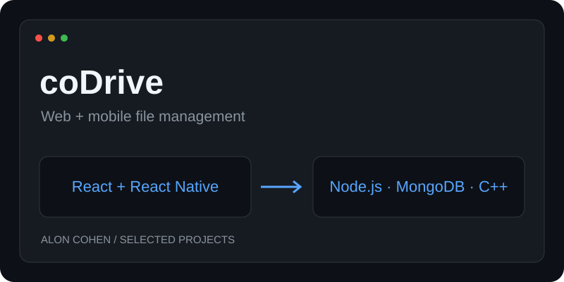
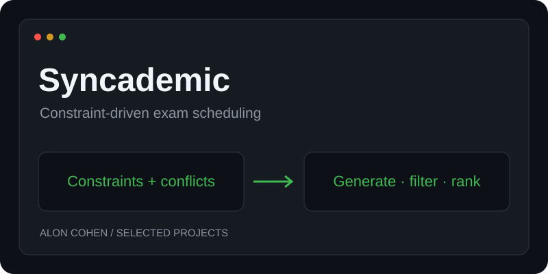

# Hi, I'm Alon Cohen 👋

### Software Engineering Student at Bar-Ilan University

Building across the stack — from C++ services to web and mobile applications.  
Interested in backend engineering, systems, algorithms, and the hardware–software interface.

---

## 👨‍💻 About Me

I'm a third-year Software Engineering student at **Bar-Ilan University**, with hands-on project experience in full-stack development, client–server systems, and algorithmic problem solving.

- **Full stack:** React and React Native clients connected to Node.js APIs and C++ services.
- **Algorithms:** constraint-based scheduling, conflict graphs, backtracking, and lazy evaluation.
- **Engineering:** modular architecture, automated testing, and containerized development.

---

## 🛠️ Technologies & Tools

### Languages

### Frameworks, Databases & Tools

**Foundations:** Data Structures & Algorithms · Object-Oriented Design · Operating Systems · Computer Architecture · Networking

---

## 🚀 Featured Projects

<table>
<tr>
<td width="50%" valign="top">

<h3>☁️ <a href="https://github.com/Alonco267/coDrive">coDrive</a></h3>

<b>Cloud-style file management across web and mobile.</b>

A team project connecting React and React Native clients to a REST API, MongoDB, and a multithreaded C++ file server.

<ul>
<li>JWT authentication and permission-based sharing</li>
<li>Files, folders, search, starred items, and trash</li>
<li>Docker Compose for the web client and backend services</li>
</ul>

<b>Tech:</b> React · React Native · Expo · Node.js · Express · MongoDB · C++ · Docker

<a href="https://github.com/Alonco267/coDrive">View repository →</a> &nbsp; <a href="https://github.com/Alonco267/coDrive/tree/main/wiki">Setup & screenshots →</a>

</td>
<td width="50%" valign="top">

<h3>📅 <a href="https://github.com/Alonco267/examSchedule">Syncademic</a></h3>

<b>Constraint-driven exam scheduling with a desktop GUI and CLI.</b>

A team project that generates valid exam timetables, filters and ranks results, and supports room and proctor assignment.

<ul>
<li>Conflict graphs and most-constrained-first backtracking</li>
<li>Lazy generation with capacity-based pruning</li>
<li>Memoized ranking and automated test coverage</li>
</ul>

<b>Tech:</b> Python · PyQt6 · pytest · CSP · Backtracking · Software Design

<a href="https://github.com/Alonco267/examSchedule">View repository →</a> &nbsp; <a href="https://github.com/Alonco267/examSchedule#installation">Run locally →</a>

</td>
</tr>
</table>

---

<b>Thanks for visiting.</b> 
Explore the repositories above for architecture, setup instructions, and implementation details.

